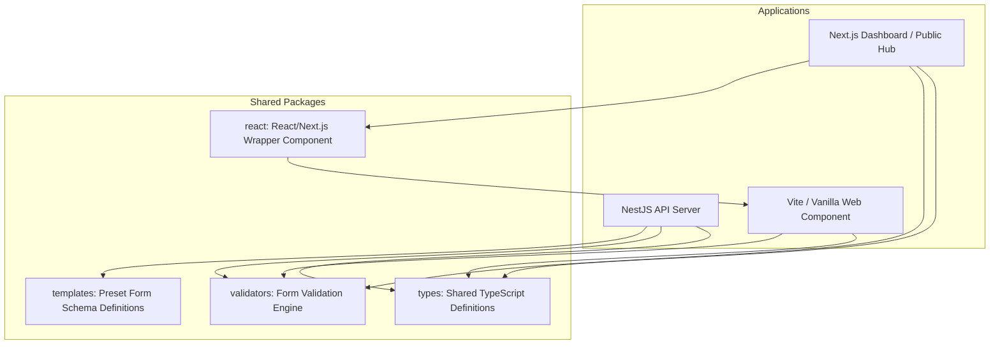
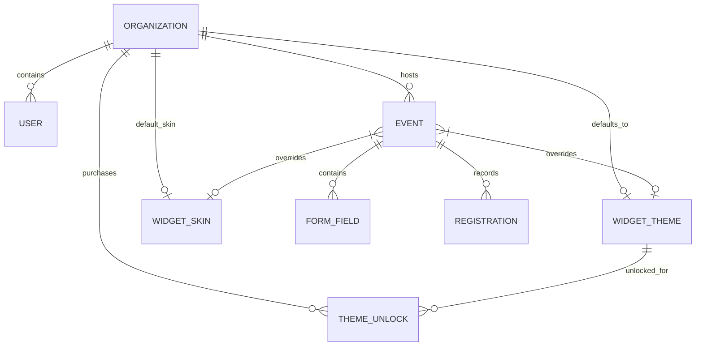

# EventsPlug Technical Documentation

EventsPlug is a self-hostable event management and registration platform. It allows organizations to customize event directories, manage registration forms using a dynamic field builder, and embed high-performance registration widgets on any webpage.

---

## 🏗️ Monorepo Architecture

EventsPlug is structured as a TypeScript monorepo, managed by `pnpm` and built with `turborepo` to enforce modularity, reusability, and rapid development.



### 📱 Applications (`/apps`)

1. **[backend](file:///Users/alen/Code/EventsPlug/apps/backend)**:
   - **Framework**: NestJS
   - **Database Access**: Prisma ORM with a PostgreSQL database
   - **Responsibilities**: Handles RESTful APIs, JSON Web Token (JWT) authentication, file uploads (using Multer), event lifecycle administration, dynamic form schemas, registrant validation, CSV export, and rate limiting.
2. **[dashboard](file:///Users/alen/Code/EventsPlug/apps/dashboard)**:
   - **Framework**: Next.js (with TailwindCSS)
   - **Responsibilities**: Represents the admin portal where organizers log in, configure event details, customize registration form fields, view registrants, monitor sign-up status, export attendee CSVs, and purchase widget themes. It also serves as the public hub directory for organizations.
3. **[widget](file:///Users/alen/Code/EventsPlug/apps/widget)**:
   - **Framework/Engine**: Vanilla TypeScript, styled with custom CSS and bundled as a Web Component via Vite.
   - **Responsibilities**: Exposes the `<event-widget>` custom element using Shadow DOM encapsulation. It fetches event configurations dynamically and displays events in **GRID**, **LIST**, or **CAROUSEL** layouts, opening an overlay form modal to process submissions client-side before sending them to the backend API.

### 📦 Shared Packages (`/packages`)

1. **[types](file:///Users/alen/Code/EventsPlug/packages/types)**:
   - Contains core TypeScript models, request/response DTO contracts, user role configurations, and widget settings shared between the client and server applications.
2. **[validators](file:///Users/alen/Code/EventsPlug/packages/validators)**:
   - A zero-dependency validation script implementing `validateForm()`. It processes user submission answers against rules (e.g., matching field formats, checkbox agreements, number parsing, email regex) and is executed *client-side* inside the widget for instant error feedback and *server-side* in NestJS controllers to enforce strict database entry security.
3. **[templates](file:///Users/alen/Code/EventsPlug/packages/templates)**:
   - Preset form builder schemas (Individual, Team, Esports Tournament, Workshop, Hackathon) that organizers can load to bootstrap form layouts.
4. **[react](file:///Users/alen/Code/EventsPlug/packages/react)**:
   - A React component wrapper (`EventsWidget`) that safely handles script injection and prevents hydration mismatches when importing the Vanilla Web Component into React/Next.js architectures.

---

## 🗄️ Database Schema & Data Model

The PostgreSQL database is managed via Prisma. The schema maps organizational structure, events, user authentication, customization options, and registered attendees.

### Key Database Entities



#### 1. `Organization`
Represents the tenant account. Owns users, events, and configuration overrides for the public events directory.
- `slug` *(String, Unique)*: Used in URLs to route users to the correct hub (e.g., `/o/my-org`).
- `defaultThemeId` / `defaultSkinId` / `defaultLayout`: Widget fallback properties when events do not declare specific overrides.
- `hubTitle` / `hubDescription` / `hubBannerUrl`: Configurations for the custom landing page.
- `hubThemeStyle`: Background theme style layout (`DOT_MATRIX`, `GRID_WARP`, `AURORA_GLOW`).

#### 2. `User`
Accounts associated with an Organization.
- `role`: Roles defined by `UserRole` enum (`ORGANIZER`, `SUPER_ADMIN`, `ADMIN`, `MANAGER`, `MEMBER`).
- `passwordHash`: Salted/hashed security password.

#### 3. `Event`
Individual events managed under an organization banner.
- `slug` *(Unique combination with organizationId)*: Friendly URL identifier.
- `maxRegistrations` *(Int, Optional)*: The cap limit of attendees allowed. If reached, registrations close.
- `status` (`EventStatus` enum): `ACTIVE`, `INACTIVE`, `DRAFT`.
- `themeId` / `skinId`: Event-specific overrides.

#### 4. `FormField`
Custom fields built dynamically for registration forms.
- `type` (`FieldType` enum): `TEXT`, `EMAIL`, `TEXTAREA`, `SELECT`, `CHECKBOX`, `NUMBER`.
- `options` *(Json, Default: '[]')*: Extends array elements for SELECT fields.
- `order` *(Int, Default: 0)*: Layout display sequencing index.

#### 5. `Registration`
Submissions stored against an Event.
- `answers` *(Json)*: Structured answers map. Matches form fields (e.g., `{ "field-uuid-1": "Jane Doe", "field-uuid-2": "jane@domain.com" }`).

#### 6. `WidgetTheme` & `WidgetSkin`
Custom stylings specifying color ratios, hues, shadows, borders, and backdrop styles.
- `isPremium` *(Boolean)*: Denotes themes that must be purchased via `OrganizationThemeUnlock`.
- `accentHue`, `accentChroma`, `surfaceTone`: Color configuration tokens.
- `backdropStyle` (`WidgetSkin`): Backdrops mapped (`DOT_MATRIX`, `GRID_WARP`, `AURORA_GLOW`).

---

## 🔌 API Gateway Endpoints

All APIs are prefixed by default. NestJS routes require JWT auth header injection unless declared public.

### 🔐 Authentication (`/api/auth`)
* `POST /api/auth/register`: Creates a tenant organization alongside the initial administrator user account. Returns metadata and jwt token.
* `POST /api/auth/login`: Authenticates organizers and retrieves a token.

### 📅 Event Management (`/events`, `/organizations/:slug/events`)
* `GET /organizations/:slug/events`: Public landing endpoint for pulling active event listings.
* `GET /organizations/:slug/events/:eventSlug`: Public details for a specific event card.
* `GET /events`: Authenticated dashboard route listing all organization events.
* `POST /events`: Creates a new event.
* `PATCH /events/:eventId`: Modifies basic details of the event.
* `DELETE /events/:eventId`: Cascades deletion down to form fields and registrations.

### 🛠️ Form Field Builder (`/events/:eventId/fields`)
* `POST /events/:eventId/fields`: Inserts a new custom form field definition. Capped at **20 fields max** per event.
* `PATCH /events/:eventId/fields/reorder`: Accepts a bulk payload to reorder field display sequencing in a single database transaction.
* `PATCH /events/:eventId/fields/:id`: Updates a field's attributes (label, placeholder, options).
* `DELETE /events/:eventId/fields/:id`: Removes a specific field definition.
* `POST /events/:eventId/fields/preset`: Replaces or appends preset template fields.

### 📝 Registrations (`/events/:eventId/register`, `/registrations`)
* `POST /events/:eventId/register`: Processes registrations. Performs server-side validations using `@eventflow/validators` and checks capacity before recording. Generates a registration code: `REG-[EVENT-SLUG-UPPERCASE]-[RANDOM-8-HEX]`.
* `GET /events/:eventId/registrations`: Returns RSVP lists.
* `GET /events/:eventId/registrations/export`: Compiles registered attendees into a clean CSV download file.
* `GET /registrations/my-registrations`: Pulls personal tickets by querying registrations where values inside the `answers` JSON match the authenticated attendee's email.

### 🎨 Customizations & Skins
* `GET /themes` / `GET /skins`: Lists style catalogs.
* `PATCH /organizations/default-theme`: Saves global organizational styling.
* `PATCH /events/:eventId/theme`: Saves event overrides.
* `GET /organizations/customization` / `PATCH /organizations/customization`: Handles Hub landing details.

---

## 🎨 Design System & Customization

The EventsPlug brand identity is defined in [CLAUDE.md](file:///Users/alen/Code/EventsPlug/CLAUDE.md) as **Sharp, Minimal, and Reliable**.

### Theme Styling Engine
The widget and pages render brand styling using custom properties (Hues, Chroma, Tone). The styling variables are mapped dynamically based on selected themes and skins:

* **Accent Coloring**: Relies on CSS variables like `--primary-color` and `--accent-color`. Organizers configure colors (validated as hex values) which propagate dynamically.
* **Layout Modes**:
  - `GRID`: Renders event decks inside responsive CSS Grid columns.
  - `LIST`: Stacks cards in single columns.
  - `CAROUSEL`: Generates a horizontally-scrollable list with snap alignments.
* **Dynamic Backdrop Styles**:
  - `DOT_MATRIX`: Renders retro dot layouts.
  - `GRID_WARP`: Visual wireframe layouts.
  - `AURORA_GLOW`: Blurry, colorful gradient blobs that animate softly.

---

## 🚀 Deployment & Integration

### Embedded HTML Widget

The widget is compiled into a single static script that registers the `<event-widget>` custom element in the DOM.

#### Standard HTML Integration
```html
<!-- Load the widget bundle script -->
<script type="module" src="https://eventsplug.com/widget.js" async></script>

<!-- Add the element anywhere in your DOM -->
<event-widget org="your-organization-slug"></event-widget>
```

#### React Wrapper Integration
For modern React and Next.js applications, use the `@eventflow/react` wrapper to avoid SSR hydration problems:
```tsx
import { EventsWidget } from '@eventflow/react';

export default function Page() {
  return (
    <main className="p-8">
      <h1 className="text-2xl font-bold">Upcoming Events</h1>
      <EventsWidget 
        org="my-org-slug" 
        scriptUrl="https://eventsplug.com/widget.js" 
      />
    </main>
  );
}
```

---

## 🛠️ Local Development & Setup

### Prerequisites
* **Node.js**: v18+
* **pnpm**: v10+
* **PostgreSQL**: Local instance or Docker container

### Getting Started

1. **Install dependencies**:
   ```bash
   pnpm install
   ```
2. **Environment Variables**:
   Copy `.env.example` configurations:
   ```bash
   cp .env.example .env
   cp apps/backend/.env.example apps/backend/.env
   ```
3. **Database Initialization**:
   Ensure Docker is active, start PostgreSQL, run Prisma migrations, and run seed data:
   ```bash
   docker compose up -d
   pnpm --filter backend exec prisma db push
   pnpm --filter backend exec prisma db seed
   ```
4. **Boot Development Servers**:
   ```bash
   pnpm dev
   ```
   * Admin Dashboard: `http://localhost:3000`
   * NestJS Server: `http://localhost:5001`
   * Widget Sandbox: `http://localhost:5173`
